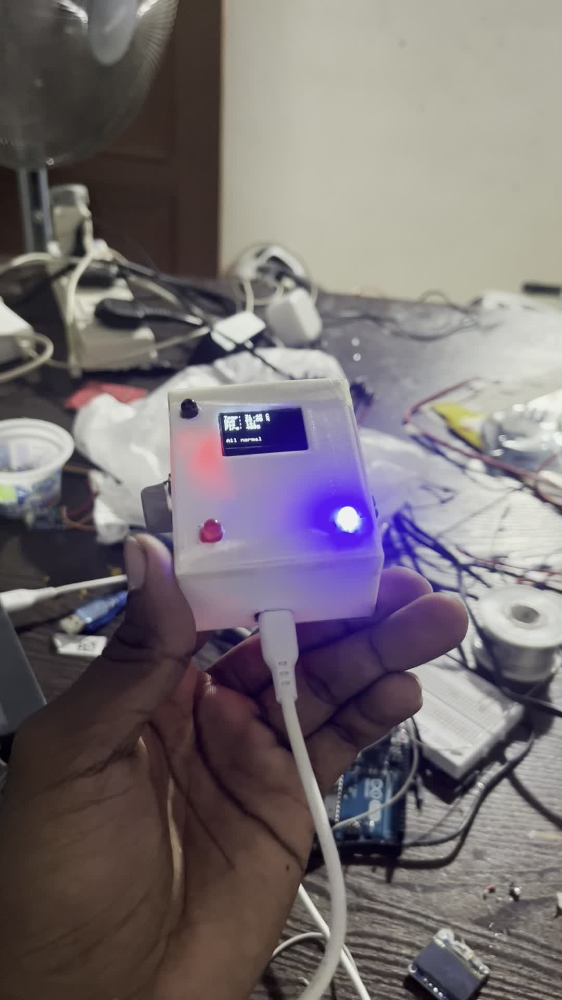
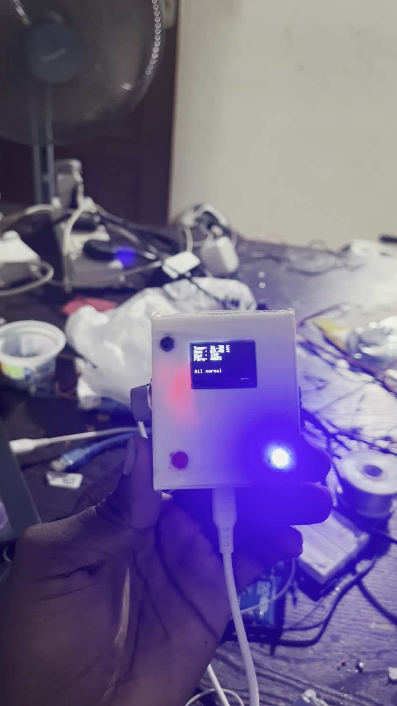

# ESP32-C3 LPG Gas Monitor

I built this gas-monitoring project using an ESP32-C3 SuperMini, an MQ-series gas sensor, a buzzer, LED indicators, a local display and Blynk. I also designed the enclosure myself and had it 3D printed at Printpro3D.lk.

[Watch the project demonstration](media/gas-monitor-demo.mp4)

## Features of the original build

- Gas-level monitoring with an MQ-series sensor. I recall it as an MQ-2, but the exact module model is not confirmed.
- Gas-level display in Blynk and a threshold-triggered Blynk alert.
- A buzzer and LED indicators on the device, with a local screen visible in the demo.
- Calibration at startup and a manual calibration option through Blynk. The original calibration algorithm and thresholds are currently unavailable.
- A custom enclosure designed by me and printed at Printpro3D.lk.

These operating details are my account of the original project. The short demo records its physical assembly and illuminated display/indicators; it does not independently validate every function or sensor accuracy.

## Fire-sensor extension

I wrote support for a fire sensor for later installation, but the sensor was not fitted to this build. This repository does not claim that fire detection was physically implemented or tested.

## Code and design files

The original Arduino sketch and enclosure CAD/STL files are on my old laptop, which broke unexpectedly. They are not currently available for this archive. No replacement code, guessed pin mapping or invented CAD files are included. If the original files can be recovered, they can be added later with credentials removed.

The original construction date is not confirmed. This repository records publication of a past completed gas-monitor build, not a claim that it was built on the commit dates.

## Actual project media

Both pictures are frames extracted from my supplied `IMG_0248.MOV`. The included MP4 is a browser-compatible conversion of that video, with camera/location metadata removed. No stock or generated project photos are included. The unrelated shoe-prototype video is excluded.

## Scope and limitations

This is a personal project archive. No calibrated concentration units, validated alarm thresholds, accuracy measurements or certified gas/fire-alarm performance are claimed. The display's status text is not proof of a validated safety condition.

See [feature evidence](docs/FEATURE_STATUS.md), [Blynk behavior](docs/BLYNK.md), [enclosure credits](docs/ENCLOSURE.md) and [source provenance](docs/PROVENANCE.md).

**Project, firmware and enclosure design:** Dileepa Nayanajith  
**Enclosure printing:** Printpro3D.lk
